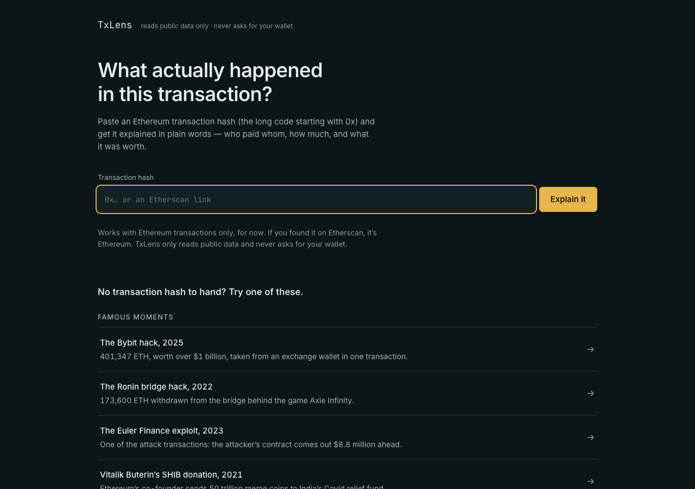
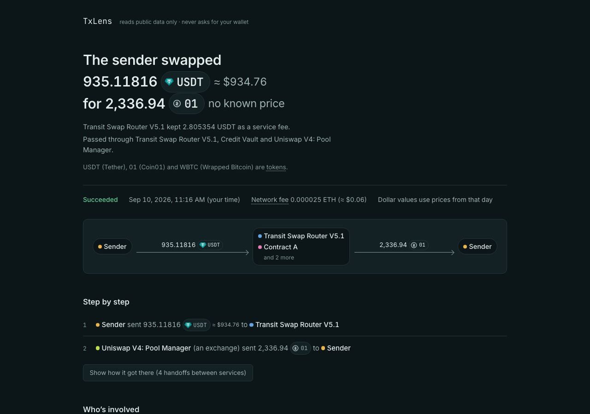

# TxLens

> Paste an EVM transaction hash. Get it explained in plain words — who paid whom, how much, and what it was worth.

[](LICENSE)
[](https://nuxt.com)
[](https://www.typescriptlang.org)
[](test/)

Block explorers show a transaction as a wall of hexadecimal. TxLens renders the same data as three things a human can read: a **narrative**, a **flow diagram**, and a **gas breakdown**.





**Read-only. No wallet connection, ever.** Nothing is signed, nothing is sent.

## What you get for a hash

- **Plain-English headline** — "The sender swapped 935.11816 USDT (≈ $934.76) for 2,336.94 01", generated by deterministic rules, not an LLM. Instant and free.
- **Token-flow strip** — sender → routers and pools → sender, with fees called out.
- **Step by step** — every hop expanded, including handoffs between services.
- **Who's involved** — named parties (routers, pools, exchanges) instead of raw addresses.
- **Gas accounting** — network fee in ETH and dollars, priced as of the transaction day.
- **Provenance chips** — the UI states which source answered (`callTracer` / internal transactions / logs only). A degraded result is never presented as complete.

Try it without a hash: the landing page lists verified famous moments (the Bybit hack, the Ronin bridge hack, the Euler exploit, Vitalik's SHIB donation) and everyday transactions (routed swaps, middleman payments, failures, batch mints).

## Guarantees

- **Read-only by design.** The client never talks to an RPC — all upstream calls go through Nitro server routes, so keys stay server-side.
- **No LLM anywhere.** Narratives are rule-based matchers, which makes them deterministic and testable. A model call here would be a regression.
- **Value is conserved.** Flow reducers may collapse, net, and group, but total in equals total out per asset — enforced by a property test.
- **Hostile input is assumed.** Contract-supplied strings (token names, symbols, revert reasons) are escaped and length-capped before rendering.
- **Degrades honestly.** The landing page renders with every upstream down (demo transactions are committed as static JSON); each data source declares its guarantees.

## Quickstart

Requires [pnpm](https://pnpm.io) (Node 20+).

```bash
pnpm install
pnpm dev        # http://localhost:3000
```

No API keys needed — it uses public indexers out of the box.

```bash
pnpm test        # vitest, 262 tests, no network
pnpm typecheck   # vue-tsc, app + tests
pnpm lint        # biome
```

## How it works

```
hash → sources → decode → flow → narrate → page
        (one adapter per upstream, common TxSource interface)
```

1. **Sources** (`server/sources/`) — Blockscout, `debug_traceTransaction` via a keyless RPC, logs. Each source has different guarantees; the registry tries them in order.
2. **Decode** (`server/decode/`) — calls and logs become typed structures. Includes an ABI resolution ladder with EIP-1967 proxy detection.
3. **Flow** (`server/flow/`) — `build.ts` normalises transfers, `reduce.ts` collapses, nets, and de-dusts them (value-conserving).
4. **Narrate** (`server/narrate/`) — one file per matcher plus an ordered registry. A new pattern is a new file plus a fixture, never a branch in an existing matcher.
5. **API** (`server/api/`) — orchestration and caching only. Finalized transactions are immutable, so cache TTL is forever; keys carry a schema version, so improving the decoder invalidates everything without a manual flush.

Everything under `decode/`, `flow/`, and `narrate/` is pure and fixture-tested.

## Project structure

```
app/            Nuxt pages + presentational components (props-driven)
server/
  sources/      upstream adapters (Blockscout, trace RPC, …)
  abi/          ABI resolution ladder + proxy detection
  decode/       calls + logs → decoded structures
  flow/         build (normalise) + reduce (collapse/net/dust)
  narrate/      ordered narrative matchers, one file each
  api/          orchestration + caching only
shared/         chains, examples, formatting helpers
test/           fixtures (recorded real transactions) + suites
scripts/        sweep + maintenance helpers
```

## Testing

Fixture-driven: every capability lands with a recorded real transaction covering it — simple transfers, ERC-20, V2 swaps, V3 multi-hop, NFT mints, ERC-1155 batches, bridge deposits, proxy calls, failed transactions with custom errors, and unverified contracts.

```bash
pnpm test
```

## Deploy

Nitro preset is `cloudflare-pages`. Bind a Cloudflare KV namespace as `TXLENS_CACHE` for persistent caching; without it, caching degrades to best-effort misses — slower, never broken. Don't cache transactions still inside the chain's reorg horizon.

## Contributing

Issues and PRs welcome. The bar: fixture first (a recorded real transaction proving the case), pure functions under `decode/`/`flow/`/`narrate/`, `pnpm test && pnpm typecheck` green. See [`docs/SPEC.md`](docs/SPEC.md) (source of truth) and [`CLAUDE.md`](CLAUDE.md) (working rules, visual direction).

## License

[MIT](LICENSE) © 2026 Shaurya Singh
